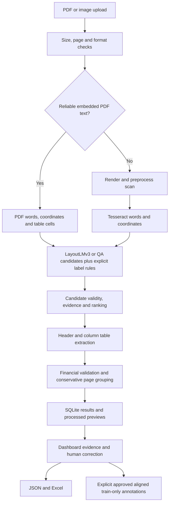

# Architecture and API

## How one document is processed



1. FastAPI accepts a bounded upload, normalizes its filename and checks its type.
2. The PDF reader selects text extraction per page. PDFium renders previews; pdfplumber provides native words/boxes and table cells. Native pages retain their coordinate system. Visible CropBox bounds are applied to both extraction and rendering, with the crop origin subtracted from word coordinates. Scans use conservative resize, denoise and deskew before Tesseract.
3. Words have pixel boxes and normalized 0-1000 boxes. LayoutLMv3 uses words, spatial information and the image for token classification. Word-aligned windows prevent silent context truncation. QA mode is a separate pretrained model.
4. Explicit label and identifier candidates remain available independently of model confidence. Format/checksum checks, supplier context and arithmetic evidence help select observed values. Credible conflicts are retained for review.
5. Native tables or header/column geometry recover rows. Wrapped descriptions, selected aliases, HSN/discount/tax fields and continuation columns are supported. This is not a trained table-structure network.
6. Document-specific checks run for invoices, bank statements and reports. Consecutive invoice IDs or explicit continuation markers support grouping. Unknown grouping evidence does not justify merging unrelated invoices.
7. Results, processed images and correction provenance persist locally. The dashboard highlights selected evidence, allows review, and exports structured results.

Extraction is serialized by a process-local semaphore. This is a local single-worker app; multiple Uvicorn workers would have separate locks and are not a supported scale-out configuration.

## Financial checks

Invoice amount parsing uses Decimal. Checks cover row multiplication/explicit row discounts, supported explicitly printed tax-inclusive rows, row sum against subtotal, subtotal + tax - discount + round-off against total, GST components, GSTIN checksum, PAN consistency and date ordering. The default invoice arithmetic tolerance is 1.00 currency unit, not a claim of statutory compliance. Bank balance tolerance is 0.01. A field's plausible syntax does not verify a tax registration against an external authority.

Bank checks use consecutive balances; financial-report checks use identifiable revenue, expenses and profit. Missing operands produce unchecked/insufficient evidence rather than a fabricated pass.

## Code map

| File | Responsibility |
|---|---|
| `backend/app.py` | API, upload limits, processing orchestration, corrections and approval |
| `backend/pdf_text.py` | Reliable native PDF words and tables with page OCR fallback |
| `backend/preprocessing.py` | Bounded decoding and scan cleanup |
| `backend/ocr_engine.py` | Tesseract language selection and word coordinates |
| `backend/layout_extractor.py` | Token/QA inference and independent field candidates |
| `backend/token_windows.py` | Word-aligned model context windows |
| `backend/candidates.py` | Validity, ranking, conflicts and source evidence |
| `backend/table_extraction.py` | Header/column and native-cell invoice rows |
| `backend/document_tables.py` | Bank/report rows and spatial evidence |
| `backend/document_summary.py` | Conservative grouping and combined reconciliation |
| `backend/validation.py` | Invoice amount/identifier/date checks |
| `backend/document_validation.py` | Document-family validation |
| `backend/storage.py` | SQLite, previews and approved reviews |
| `backend/review_training.py` | Human-approved token alignment and reserved-data guards |
| `backend/exports.py` | Nine-sheet Excel export |
| `frontend/streamlit_app.py` | Upload, source evidence, editable review and downloads |
| `notebooks/finetune_layoutlmv3.py` | Reproducible training/evaluation |
| `scripts/finish_upgrade.ps1` | Training completion, evaluation, deployment and handover |

## API routes

Use http://127.0.0.1:8000/docs for interactive schemas. Examples assume an already running app and use `curl.exe` on Windows.

| Method and route | Purpose |
|---|---|
| GET `/health` | OCR availability, mode and configured token checkpoint name; does not itself run inference |
| GET `/sample-fields` | Supported extraction fields |
| POST `/extract` | Multipart upload -> full JSON result |
| POST `/extract-to-excel` | Multipart upload -> workbook |
| GET `/documents?q=...` | Saved-document filename search |
| GET `/documents/{id}` | Full saved result |
| PATCH `/documents/{id}` | Save one page's field/items/transaction corrections |
| GET `/documents/{id}/excel` | Saved result workbook |
| GET `/documents/{id}/pages/{n}/preview` | Exact stored processed PNG for highlighting |
| POST `/documents/{id}/pages/{n}/approve-training` | Explicit reviewed-page annotation approval |
| GET `/training-reviews` | Saved training-approval records |

```powershell
curl.exe http://127.0.0.1:8000/health
curl.exe -X POST http://127.0.0.1:8000/extract -F "file=@sample_docs/demo_digital_invoice.pdf"
```

Python correction example:

```python
import requests
base = 'http://127.0.0.1:8000'
with open('sample_docs/demo_digital_invoice.pdf', 'rb') as file:
    response = requests.post(base + '/extract', files={'file': file}, timeout=300)
response.raise_for_status()
result = response.json()
response = requests.patch(base + '/documents/' + result['id'], json={
    'page': 1,
    'fields': {'invoice_number': 'VALUE_VERIFIED_ON_SOURCE'},
}, timeout=30)
response.raise_for_status()
```

Only enter the value actually visible on your source; the placeholder is an API example, not demo ground truth. Omit `line_items`/`transactions` to preserve them; an explicit empty list clears that page's rows.

## Important response fields

`pages[].fields[field]` includes value, source, confidence, evidence and candidates where available. `extraction_diagnostics.token_model` reports executed/failed/not-requested, model name, device, predictions and confidence gate. Inspect final field sources as well: model execution does not mean its values won selection.

`document_summary` contains grouped documents, merged rows, source-page references and combined validation. `source_sha256` identifies the original upload without retaining its bytes. `reviewed_at` records review; `original` retains extracted values after correction.

## Extension boundaries

Learned table structure, robust handwriting/Hindi benchmarks, authentication, external tax verification and production multi-user deployment remain future work. Core transaction/report extraction uses heuristics. Adding more examples to a folder does not automatically train the model; human approval does not automatically update model weights.
